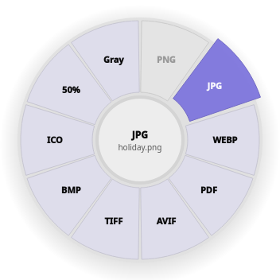
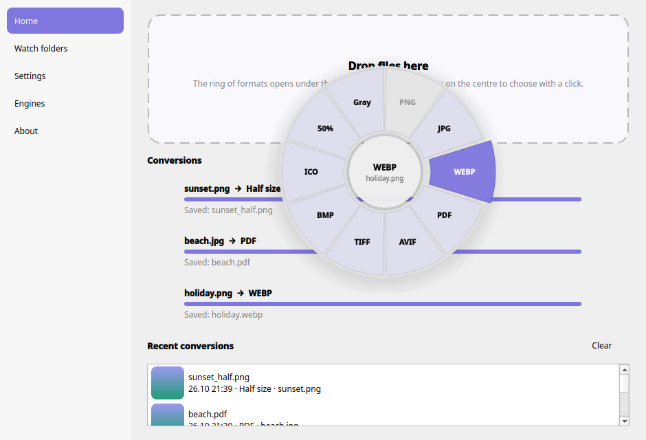
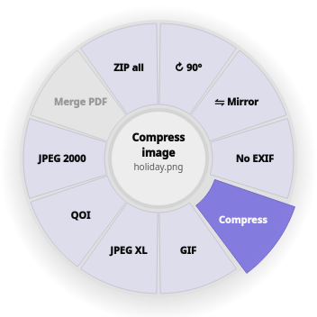

<p align="center">
  
</p>

<h1 align="center">Dropring</h1>

<p align="center">
  <b>Drag a file, drop it on a format. That's the whole idea.</b><br>
  A friendly file converter for Linux that opens a ring of formats right where your mouse is.
</p>

<p align="center">
  <b>English</b> · <a href="README.tr.md">Türkçe</a>
</p>

---

Converting files on Linux usually means remembering a different command for every kind of file, or uploading
your files to some website. Dropring does it differently. You pick the files, and a ring of formats pops up under
your cursor. Only the formats that make sense for those files are shown. Click one and the converted file appears
right next to the original. Everything happens on your own computer; nothing is uploaded anywhere.

It's inspired by [Filee](https://github.com/KnifeLemon/Filee) (Windows/macOS) and was written from scratch for Linux
desktops, especially **KDE Plasma on Wayland**.

<p align="center">
  
</p>

## What can it do?

- **Pictures:** PNG, JPG, WEBP, AVIF, TIFF, BMP, GIF, ICO, JPEG XL, QOI, JPEG 2000, PSD, SVG, camera RAW…
  Turn pictures into a PDF, shrink them to half size, make them grayscale, rotate, mirror, strip location/EXIF data
  or compress them.
- **Video:** MP4, MKV, WEBM, MOV, AVI, WMV, OGV… Turn a video into a GIF, pull the sound out as MP3, make it smaller,
  remove the sound, or grab a still frame.
- **Audio:** MP3, WAV, FLAC, OGG, OPUS, M4A, AAC, WMA, AIFF, in any direction.
- **Documents:** DOCX, DOC, ODT, RTF, TXT, HTML, Markdown → PDF, Word, EPUB, plain text and more.
  PDF → Word, text, or one picture per page. Compress a PDF, or **merge several files into one PDF**.
- **Spreadsheets and presentations:** XLSX, XLS, ODS, CSV, PPTX, PPT, ODP → PDF and to each other.
- **Archives:** extract ZIP, 7Z, RAR and TAR files, convert between them, or zip up a bunch of files in one go.

If there's no direct way from one format to another, Dropring finds a route through other formats on its own.
For example, Word → PNG goes through PDF.

## How to use it

There are three ways to open the ring. Use whichever feels natural.

**1. Drag files onto the Dropring window.**
The ring opens under your cursor while you're still dragging. Let go over a format and you're done.
If you'd rather click, drop the files in the middle of the ring, then click a format.

**2. Right-click in Dolphin (or your file manager).**
Select files, right-click, and choose **Convert with Dropring…** to open the ring.
There's also a **Convert to ▸** submenu with the most common formats for that file type if you want to skip the ring.

**3. Keyboard shortcut.**
Select files in Dolphin, press <kbd>Ctrl</kbd>+<kbd>C</kbd>, then press <kbd>Meta</kbd>+<kbd>Shift</kbd>+<kbd>C</kbd>
(Meta is the Windows key). The ring opens for the files you just copied.

### While the ring is open



| Key | What it does |
|---|---|
| <kbd>Tab</kbd>, <kbd>Space</kbd> or the mouse wheel | Flip the ring over to the back side, with less common formats and tools such as rotate, compress and remove EXIF |
| <kbd>←</kbd> <kbd>→</kbd> + <kbd>Enter</kbd> | Choose a format with the keyboard |
| <kbd>1</kbd> … <kbd>9</kbd> | Pick a slice directly |
| <kbd>Esc</kbd> or click outside | Close the ring |

Greyed-out slices don't work for the files you picked. Hover over one and the middle of the ring tells you why
(for example "Already PNG").

Converted files are saved **next to the original** under the same name with the new extension. If a file with that
name already exists, Dropring adds a number, like `photo (2).jpg`. **Your original file is never overwritten.**

<br clear="right">

## Installing

You need Python 3.10 or newer, PySide6 (Qt for Python), and the conversion tools for the formats you care about.
You don't need all of them. If a tool is missing, Dropring simply hides the formats that tool would handle.

**Fedora**
```sh
sudo dnf install python3-pyside6 ImageMagick ffmpeg libreoffice poppler-utils ghostscript p7zip p7zip-plugins wl-clipboard
```

**Ubuntu / Debian**
```sh
sudo apt install python3-pyside6.qtwidgets python3-pyside6.qtnetwork imagemagick ffmpeg libreoffice poppler-utils ghostscript 7zip wl-clipboard
```

**Arch**
```sh
sudo pacman -S pyside6 imagemagick ffmpeg libreoffice-fresh poppler ghostscript 7zip wl-clipboard
```

Then download Dropring and run the installer. It doesn't need root and only touches your own home folder:

```sh
git clone https://github.com/dogukanulutas/dropring.git
cd dropring
./install.sh
```

The installer:

- puts Dropring in `~/.local/share/dropring` and the `dropring` command in `~/.local/bin`,
- adds Dropring to your app menu,
- adds the **Convert with Dropring…** and **Convert to ▸** entries to Dolphin's right-click menu (and a script for Nautilus on GNOME),
- starts Dropring in the system tray now and every time you log in. The keyboard shortcut only works while it's running.
  If you don't want that, use `./install.sh --no-autostart`.

To update, run `git pull` and then `./install.sh` again. Your settings are kept.

To remove it, run `./uninstall.sh`. Your settings and history stay unless you add `--purge`.
Files you converted are never deleted.

## Settings

Open Dropring from the app menu or click the tray icon.

- **Where results go:** next to the original (the default), in a subfolder such as `converted/`, or always into one
  folder you choose. You can also change the file name pattern, for example `{name}-{date}`.
- **When a file already exists:** add a number, replace it, or skip.
- **Watch folders:** pick a folder and a format, and every new file that lands there is converted automatically.
  Handy for a "scans" or "downloads" folder. Results go into a subfolder so they don't get converted again.
- **Keyboard shortcut:** change or turn off Meta+Shift+C.
- **Look:** accent colour, ring opacity, animations, and language (English / Türkçe).
- **Engines:** shows which conversion tools Dropring found on your system.

## Command line

Everything works from the terminal too:

```sh
dropring convert *.png --to webp                    # convert files
dropring convert scan1.jpg scan2.jpg --to merge-pdf  # merge into one PDF
dropring convert holiday.mp4 --to compress-video --subfolder small
dropring convert report.docx --to pdf --out ~/Exports --name "{name}-{date}"
dropring watch ~/Downloads/scans --to pdf           # convert every new file in a folder
dropring formats                                    # what can become what on this computer
dropring presets photo.jpg                          # which options a file gets in the ring
dropring engines                                    # which tools were found
```

`--to` takes a format name (`jpg`, `mp3`, `pdf`…) or a tool name (`half-size`, `grayscale`, `compress-pdf`,
`merge-pdf`, `zip-all`, `extract`…). Run `dropring presets` to see them all.

## Questions and problems

**Why doesn't "hold Ctrl and drag anywhere" work, like in Filee?**
Wayland doesn't let one app watch the mouse and keyboard of other apps. That's good for security, but it rules out
that trick. That's why Dropring uses the window, the right-click menu and the copy + shortcut combination instead.

**The shortcut does nothing.**
Make sure Dropring is running; you should see its icon in the tray. Check that you copied the files with
<kbd>Ctrl</kbd>+<kbd>C</kbd> first, and that `wl-clipboard` is installed. On desktops other than KDE, add a custom
shortcut in your system settings that runs `dropring menu --clipboard`.

**A format I need is missing or greyed out.**
Open **Engines** in Dropring, or run `dropring engines`, and install whatever is marked missing. For example, HEIC
photos need an ImageMagick build with HEIC support.

**I have two monitors. Will the ring show up on the right one?**
Yes. Dropring opens an invisible layer on each screen, and the ring appears on the screen where your mouse is.

**Something went wrong.**
Dropring keeps a log at `~/.cache/dropring/dropring.log`. Please attach it when you
[open an issue](https://github.com/dogukanulutas/dropring/issues).

## For developers

```sh
python3 -m dropring                                                  # run from the source folder
QT_QPA_PLATFORM=offscreen python3 -m unittest discover -s tests -t .  # run the tests
```

How it fits together:

- `formats.py` knows the formats,
- `engines.py` wraps each tool (ImageMagick, FFmpeg, LibreOffice…) and says which conversions it can do,
- `planner.py` finds the cheapest route between two formats (at most 3 steps),
- `presets.py` decides which slices each kind of file gets,
- `jobs.py` runs conversions in parallel,
- `gui/` is the Qt app.

To add a new tool, write a small `Engine` class in `engines.py`. Its conversions show up everywhere automatically.

## Thanks

The idea comes from [Filee](https://github.com/KnifeLemon/Filee) by KnifeLemon. The actual work is done by
ImageMagick, FFmpeg, LibreOffice, Poppler and Ghostscript.

## License

MIT. Use it, change it, share it.
