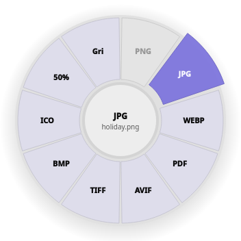
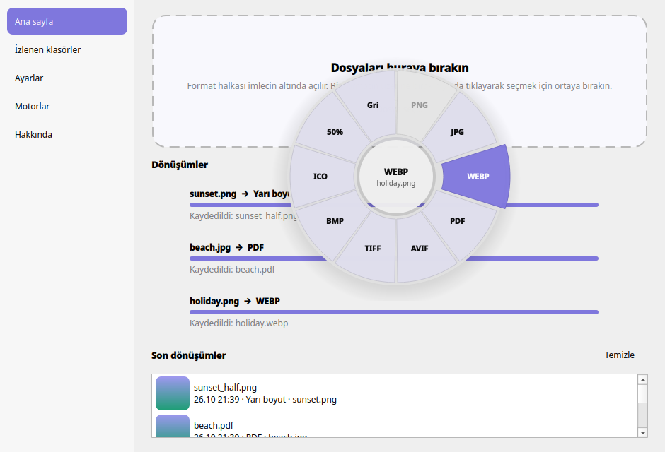
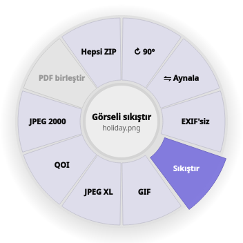

<p align="center">
  
</p>

<h1 align="center">Dropring</h1>

<p align="center">
  <b>Dosyayı sürükle, bir formatın üstüne bırak. Hepsi bu.</b><br>
  Fare imlecinin olduğu yerde bir format halkası açan, kullanımı kolay bir Linux dosya dönüştürücü.
</p>

<p align="center">
  <a href="README.md">English</a> · <b>Türkçe</b>
</p>

---

Linux'ta dosya dönüştürmek genelde her dosya türü için ayrı bir komut hatırlamak ya da dosyaları bir siteye
yüklemek demek. Dropring bunu başka türlü yapıyor. Dosyaları seçiyorsun, imlecin altında bir format halkası
beliriyor. Halkada yalnızca o dosyalar için anlamlı formatlar var. Birine tıklıyorsun, dönüştürülmüş dosya
orijinalin hemen yanında beliriyor. Her şey kendi bilgisayarında oluyor; hiçbir şey bir yere yüklenmiyor.

[Filee](https://github.com/KnifeLemon/Filee)'den (Windows/macOS) esinlenildi ve Linux masaüstleri için, özellikle
**Wayland üzerinde KDE Plasma** için sıfırdan yazıldı.

<p align="center">
  
</p>

## Neler yapabiliyor?

- **Resimler:** PNG, JPG, WEBP, AVIF, TIFF, BMP, GIF, ICO, JPEG XL, QOI, JPEG 2000, PSD, SVG, kamera RAW…
  Resimleri PDF yap, yarı boyuta küçült, siyah beyaz yap, döndür, aynala, konum/EXIF bilgisini sil ya da sıkıştır.
- **Video:** MP4, MKV, WEBM, MOV, AVI, WMV, OGV… Videoyu GIF yap, sesini MP3 olarak çıkar, boyutunu küçült,
  sesini kaldır ya da bir kare al.
- **Ses:** MP3, WAV, FLAC, OGG, OPUS, M4A, AAC, WMA, AIFF arasında her yöne.
- **Belgeler:** DOCX, DOC, ODT, RTF, TXT, HTML, Markdown → PDF, Word, EPUB, düz metin ve daha fazlası.
  PDF → Word, metin ya da her sayfa için bir resim. PDF'i sıkıştır ya da **birden fazla dosyayı tek PDF'te birleştir**.
- **Tablolar ve sunumlar:** XLSX, XLS, ODS, CSV, PPTX, PPT, ODP → PDF ve birbirlerine.
- **Arşivler:** ZIP, 7Z, RAR ve TAR dosyalarını aç, birbirine dönüştür ya da bir sürü dosyayı tek seferde ZIP'le.

Bir formattan diğerine doğrudan yol yoksa Dropring başka formatların üzerinden kendisi bir yol buluyor.
Örneğin Word → PNG dönüşümü PDF üzerinden yapılıyor.

## Nasıl kullanılır?

Halkayı açmanın üç yolu var. Hangisi sana daha doğal geliyorsa onu kullan.

**1. Dosyaları Dropring penceresine sürükle.**
Halka, sen daha sürüklerken imlecin altında açılır. Bir formatın üstünde bırakman yeterli.
Tıklamayı tercih edersen dosyaları halkanın ortasına bırak, sonra bir formata tıkla.

**2. Dolphin'de (ya da dosya yöneticinde) sağ tıkla.**
Dosyaları seç, sağ tıkla ve halkayı açmak için **Dropring ile dönüştür…** seçeneğine bas.
Halkayı atlamak istersen o dosya türünün en sık kullanılan formatlarını içeren bir **Şuna dönüştür ▸** alt menüsü de var.

**3. Klavye kısayolu.**
Dolphin'de dosyaları seç, <kbd>Ctrl</kbd>+<kbd>C</kbd>'ye bas, sonra <kbd>Meta</kbd>+<kbd>Shift</kbd>+<kbd>C</kbd>'ye
bas (Meta, Windows tuşudur). Halka az önce kopyaladığın dosyalar için açılır.

### Halka açıkken



| Tuş | Ne yapar |
|---|---|
| <kbd>Tab</kbd>, <kbd>Boşluk</kbd> ya da fare tekerleği | Halkayı arka yüzüne çevirir: daha az kullanılan formatlar ve döndürme, sıkıştırma, EXIF silme gibi araçlar |
| <kbd>←</kbd> <kbd>→</kbd> + <kbd>Enter</kbd> | Klavyeyle format seçer |
| <kbd>1</kbd> … <kbd>9</kbd> | Dilimi doğrudan seçer |
| <kbd>Esc</kbd> ya da dışarı tıklamak | Halkayı kapatır |

Soluk görünen dilimler seçtiğin dosyalar için çalışmaz. Üstüne geldiğinde halkanın ortasında nedeni yazar
(örneğin "Zaten PNG").

Dönüştürülen dosyalar **orijinalin yanına**, aynı adla ve yeni uzantıyla kaydedilir. O adda bir dosya zaten varsa
Dropring sonuna `foto (2).jpg` gibi bir numara ekler. **Orijinal dosyanın üzerine asla yazılmaz.**

<br clear="right">

## Kurulum

Python 3.10 veya üstü, PySide6 (Python için Qt) ve ihtiyacın olan formatların dönüştürme araçları gerekiyor.
Hepsine ihtiyacın yok. Bir araç eksikse Dropring yalnızca o aracın işlediği formatları gizler.

**Fedora**
```sh
sudo dnf install python3-pyside6 ImageMagick ffmpeg libreoffice poppler-utils ghostscript p7zip p7zip-plugins wl-clipboard
```

**Ubuntu / Debian**
```sh
sudo apt install python3-pyside6.qtwidgets python3-pyside6.qtnetwork imagemagick ffmpeg libreoffice poppler-utils ghostscript 7zip wl-clipboard
```

**Arch**
```sh
sudo pacman -S pyside6 imagemagick ffmpeg libreoffice-fresh poppler ghostscript 7zip wl-clipboard
```

Sonra Dropring'i indirip kurulum betiğini çalıştır. Root yetkisi istemez, yalnızca kendi ev klasörüne dokunur:

```sh
git clone https://github.com/dogukanulutas/dropring.git
cd dropring
./install.sh
```

Kurulum betiği şunları yapar:

- Dropring'i `~/.local/share/dropring` klasörüne, `dropring` komutunu `~/.local/bin` klasörüne koyar,
- Dropring'i uygulama menüne ekler,
- Dolphin'in sağ tık menüsüne **Dropring ile dönüştür…** ve **Şuna dönüştür ▸** seçeneklerini ekler (GNOME'da Nautilus için de bir betik),
- Dropring'i şimdi ve her oturum açışında sistem tepsisinde başlatır. Klavye kısayolu yalnızca Dropring çalışırken işe yarar.
  Bunu istemiyorsan `./install.sh --no-autostart` kullan.

Güncellemek için `git pull` yapıp `./install.sh` komutunu yeniden çalıştır. Ayarların korunur.

Kaldırmak için `./uninstall.sh` çalıştır. `--purge` eklemezsen ayarların ve geçmişin kalır.
Dönüştürdüğün dosyalar asla silinmez.

## Ayarlar

Dropring'i uygulama menüsünden aç ya da tepsideki simgesine tıkla.

- **Sonuçlar nereye kaydedilsin:** orijinalin yanına (varsayılan), `converted/` gibi bir alt klasöre ya da her zaman
  seçtiğin tek bir klasöre. Dosya adı kalıbını da değiştirebilirsin, örneğin `{name}-{date}`.
- **Dosya zaten varsa:** numara ekle, üzerine yaz ya da atla.
- **İzlenen klasörler:** bir klasör ve bir format seç; o klasöre düşen her yeni dosya kendiliğinden dönüştürülür.
  "Taramalar" ya da "İndirilenler" gibi bir klasör için çok işe yarar. Sonuçlar bir alt klasöre yazılır, böylece
  tekrar dönüştürülmezler.
- **Klavye kısayolu:** Meta+Shift+C kısayolunu değiştir ya da kapat.
- **Görünüm:** vurgu rengi, halka opaklığı, animasyonlar ve dil (English / Türkçe).
- **Motorlar:** Dropring'in sisteminde hangi dönüştürme araçlarını bulduğunu gösterir.

## Komut satırı

Her şey terminalden de çalışır:

```sh
dropring convert *.png --to webp                    # dosyaları dönüştür
dropring convert tarama1.jpg tarama2.jpg --to merge-pdf  # tek PDF'te birleştir
dropring convert tatil.mp4 --to compress-video --subfolder kucuk
dropring convert rapor.docx --to pdf --out ~/Belgeler --name "{name}-{date}"
dropring watch ~/İndirilenler/taramalar --to pdf    # klasöre gelen her yeni dosyayı dönüştür
dropring formats                                    # bu bilgisayarda neyin neye dönüşebildiği
dropring presets foto.jpg                           # bir dosyanın halkada hangi seçenekleri aldığı
dropring engines                                    # hangi araçların bulunduğu
```

`--to` bir format adı (`jpg`, `mp3`, `pdf`…) ya da bir araç adı (`half-size`, `grayscale`, `compress-pdf`,
`merge-pdf`, `zip-all`, `extract`…) alır. Hepsini görmek için `dropring presets` çalıştır.

## Sorular ve sorunlar

**Filee'deki gibi "Ctrl'ye basılı tutup herhangi bir yerde sürükleme" neden yok?**
Wayland, bir uygulamanın başka uygulamaların fare ve klavye hareketlerini izlemesine izin vermiyor. Bu güvenlik
açısından iyi bir şey, ama o yöntemi imkânsız kılıyor. Bu yüzden Dropring pencereyi, sağ tık menüsünü ve
kopyala + kısayol birleşimini kullanıyor.

**Kısayol hiçbir şey yapmıyor.**
Dropring'in çalıştığından emin ol; tepside simgesini görmelisin. Dosyaları önce <kbd>Ctrl</kbd>+<kbd>C</kbd> ile
kopyaladığını ve `wl-clipboard` paketinin kurulu olduğunu kontrol et. KDE dışındaki masaüstlerinde sistem
ayarlarından `dropring menu --clipboard` komutunu çalıştıran özel bir kısayol ekle.

**İhtiyacım olan bir format yok ya da soluk görünüyor.**
Dropring'de **Motorlar** sayfasını aç ya da `dropring engines` çalıştır ve eksik görünen aracı kur. Örneğin HEIC
fotoğraflar için HEIC desteğiyle derlenmiş bir ImageMagick gerekir.

**İki monitörüm var. Halka doğru ekranda çıkar mı?**
Evet. Dropring her ekranda görünmez bir katman açar; halka faren hangi ekrandaysa orada belirir.

**Bir şeyler ters gitti.**
Dropring `~/.cache/dropring/dropring.log` dosyasına kayıt tutar.
[Bir sorun bildirirken](https://github.com/dogukanulutas/dropring/issues) bu dosyayı da eklersen çok yardımcı olur.

## Geliştiriciler için

```sh
python3 -m dropring                                                  # kaynak klasöründen çalıştır
QT_QPA_PLATFORM=offscreen python3 -m unittest discover -s tests -t .  # testleri çalıştır
```

Parçalar şöyle bir araya geliyor:

- `formats.py` formatları tanır,
- `engines.py` her aracı (ImageMagick, FFmpeg, LibreOffice…) sarar ve hangi dönüşümleri yapabildiğini söyler,
- `planner.py` iki format arasındaki en ucuz yolu bulur (en fazla 3 adım),
- `presets.py` her dosya türünün halkada hangi dilimleri alacağına karar verir,
- `jobs.py` dönüşümleri paralel çalıştırır,
- `gui/` Qt uygulamasıdır.

Yeni bir araç eklemek için `engines.py` içine küçük bir `Engine` sınıfı yaz. Yapabildiği dönüşümler her yerde
kendiliğinden görünür.

## Teşekkürler

Fikir KnifeLemon'un [Filee](https://github.com/KnifeLemon/Filee) projesinden geliyor. Asıl işi ImageMagick, FFmpeg,
LibreOffice, Poppler ve Ghostscript yapıyor.

## Lisans

MIT. İstediğin gibi kullan, değiştir, paylaş.
